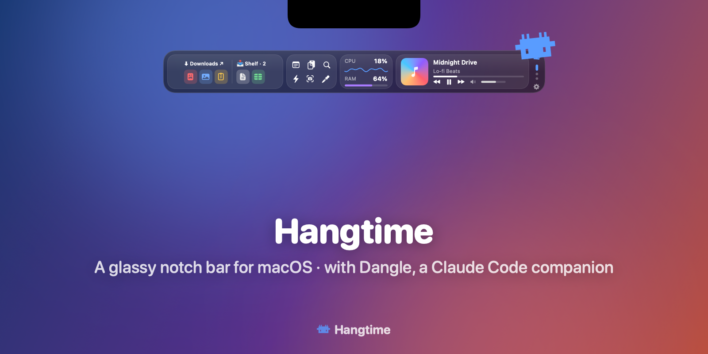
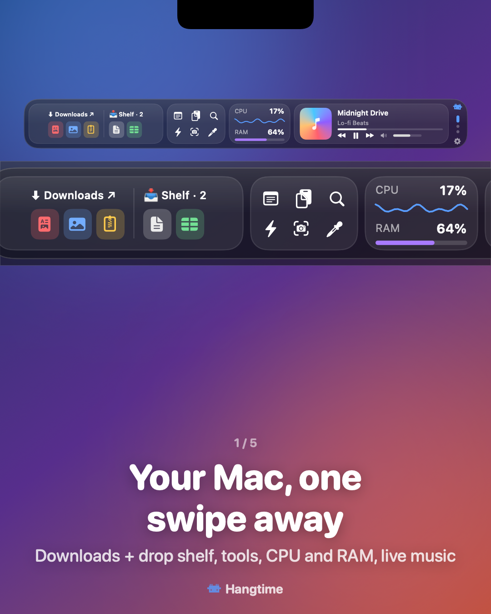
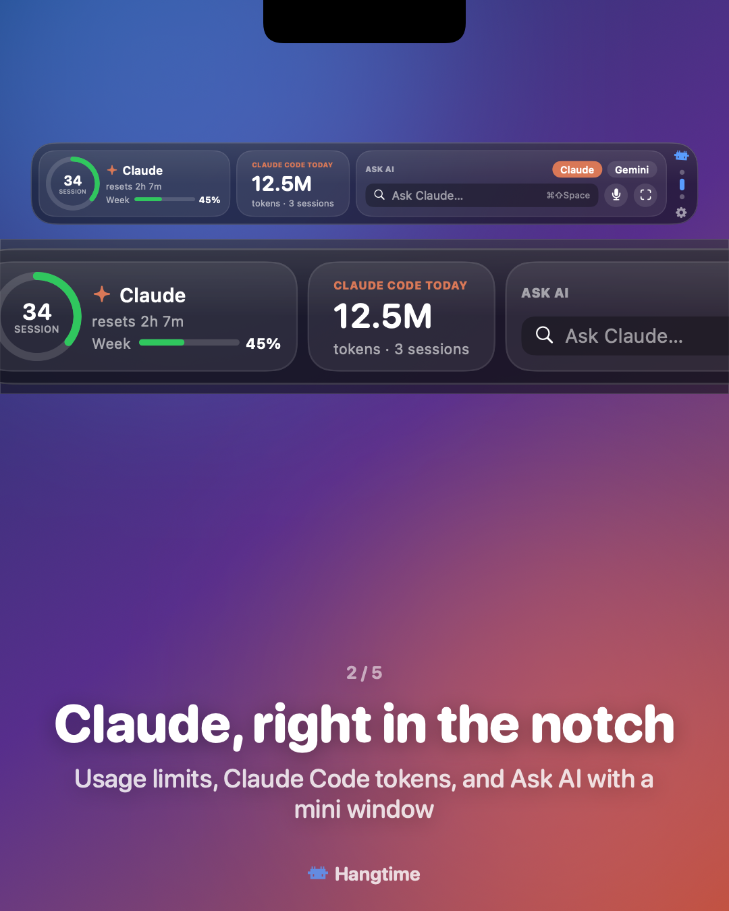
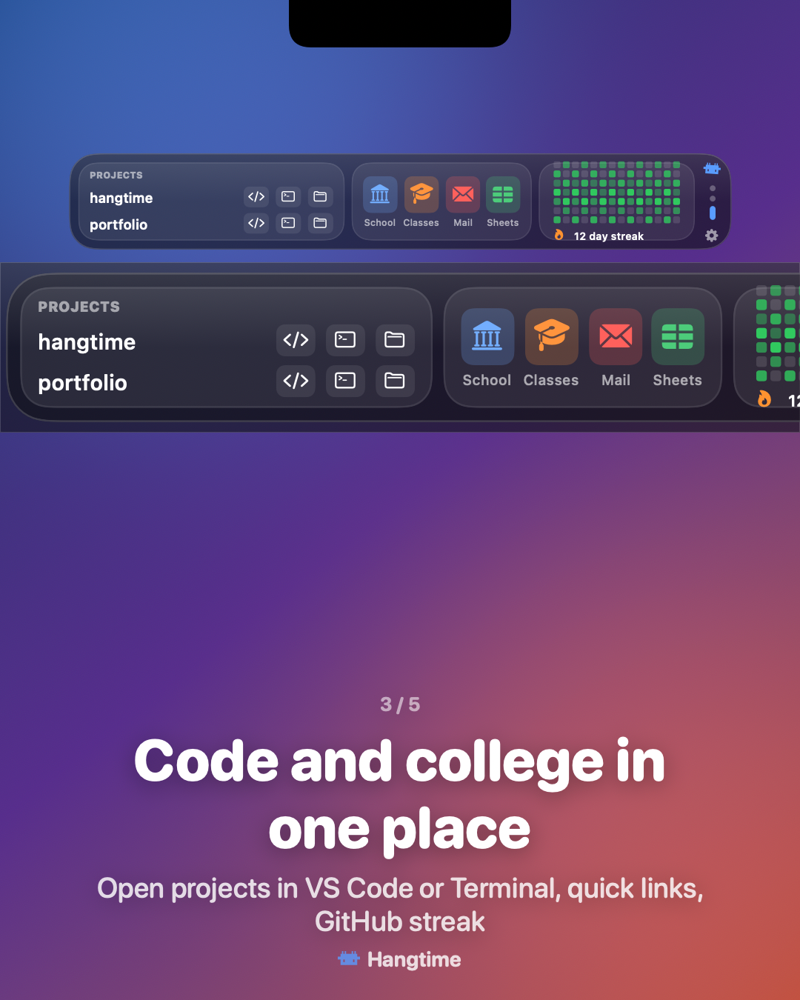
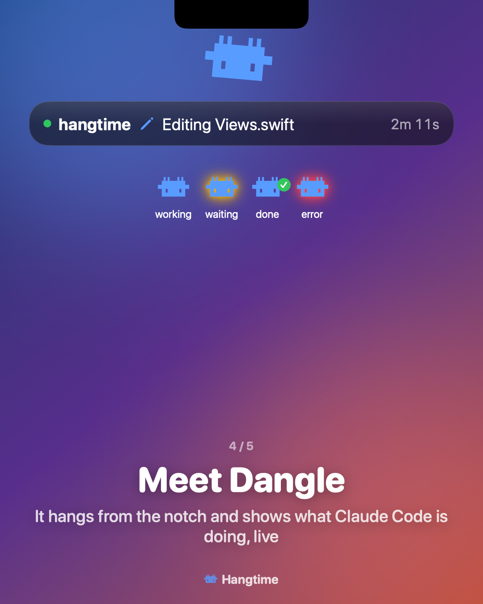
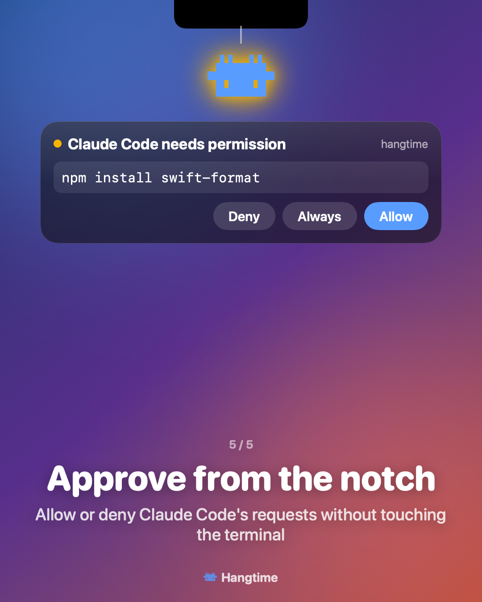
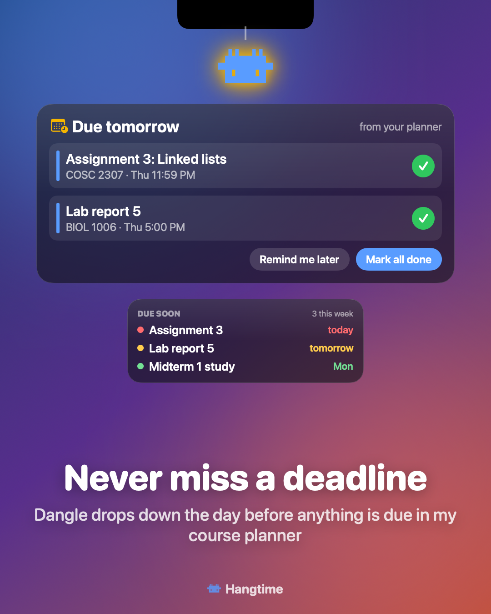
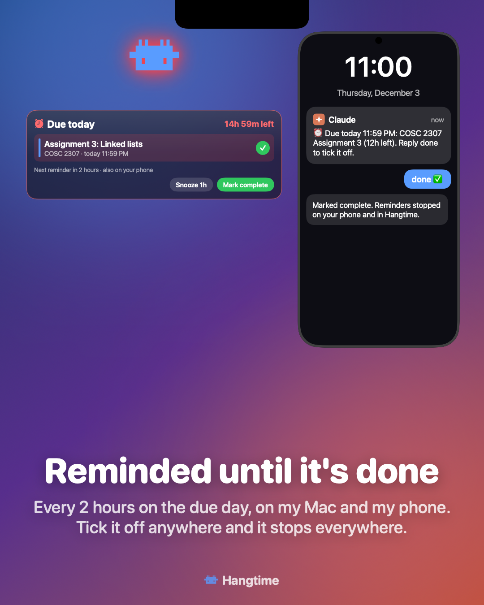

<p align="center"></p>

# Hangtime

A glassy bar that drops down from your MacBook's notch, plus **Dangle**: a little Claude Code companion that hangs from the notch, shows what your AI agent is doing, and lets you approve its requests without touching the terminal.

Built with Swift and SwiftUI, with [Claude Code](https://claude.com/claude-code) as my pair programmer.

<p align="center">
  
  
  
</p>

## Features

**Mac page**
- **Downloads + Shelf**: click to open your Downloads folder; drop files on the shelf and drag them out into any upload box.
- **Tools**: quick notes, clipboard history (skips passwords from password managers), web search, screenshot, colour picker.
- **CPU + RAM** live graph and memory bar.
- **Now playing** with live cover art for YouTube Music in Chrome, Spotify and Apple Music, plus controls and volume.

**Claude page**
- **Claude usage**: session and weekly limits, with a pop-up at 85%.
- **Claude Code today**: tokens and sessions, read from Claude Code's own logs on your Mac.
- **Ask AI**: a mini Claude or Gemini window in the top-left corner (⌘⇧Space), with dictation and screen search.

**Code page**
- **Projects**: finds your code folders and opens them in VS Code, Terminal, Finder or GitHub.
- **Quick links** that open in Chrome (editable).
- **GitHub** contribution grid and streak.

<p align="center">
  
  
</p>

**Dangle, the Claude Code companion**
- Hangs upside down from the notch in your accent colour and swings while Claude works.
- A live pill shows what's happening: *Editing Views.swift · 2m 14s*, *Running swift build*.
- When Claude needs permission it drops down, glows amber, and shows **Allow / Always / Deny**.
- Bounces with a ✓ when a task is done and lists every file changed (click to open in VS Code).

<p align="center">
  
  
</p>

**Deadline reminders**
- A **Due soon** tile lists what's coming up, colour-coded: today, tomorrow, later.
- The day before something is due, Dangle drops down with a **Due tomorrow** card at 9 AM.
- On the due day it comes back **every 2 hours** with a countdown until you mark it complete.
- Optional phone reminders with a **Mark complete** button, through the free [ntfy](https://ntfy.sh) app (Android or iPhone) or a Claude scheduled task. Marking it done anywhere stops the reminders everywhere.
- Deadlines live in `~/Library/Application Support/Hangtime/deadlines.json`, outside the code, so your courses stay private. Hangtime reloads the file when it changes.

## How the Claude Code connection works

Hangtime adds [hooks](https://code.claude.com/docs/en/hooks) to `~/.claude/settings.json` (a backup is kept). Claude Code runs `~/.hangtime/hook.sh` at key moments; the script passes the event to Hangtime over `127.0.0.1` only, protected by a random token. If Hangtime isn't running, the script does nothing and Claude Code behaves exactly as normal. You can disconnect any time from the Dangle menu.

## Build and run

Requirements: macOS 13 or later and Apple's Command Line Tools (no full Xcode needed).

```bash
./build.command
```

It compiles the app into `~/Applications/Hangtime.app` and starts it. Move the mouse to the top middle of the screen to drop the bar down; **⌃⌥Space** keeps it open.

**Keep permissions between builds:** create a self-signed code-signing certificate called **Hangtime Developer** in Keychain Access (steps at the top of `build.command`). Then open **Settings → Grant all** in the bar once.

## Project layout

| File | What it does |
|---|---|
| `Sources/main.swift` | The floating bar window, show/hide, shortcuts |
| `Sources/Views.swift` | Shared building blocks, the bar, settings |
| `Sources/Widgets*.swift` | The widgets on each page |
| `Sources/ClaudeCode.swift` | Claude Code bridge: hooks, local server, sessions, files changed, token usage |
| `Sources/Dangle.swift` | The Dangle character and its moods |
| `Sources/Notices.swift` | Notch pop-ups: activity pill, permission requests, alerts |
| `Sources/Deadlines.swift` | Deadline reminders, Due soon tile, phone push |
| `Sources/MiniWindow.swift` | Mini Claude / Gemini window |
| `promo/` | Renders the showcase images (`--images`) and a promo reel |

## Notes

- Dangle uses the Claude Code character, which belongs to Anthropic. This is a personal, unofficial project and isn't affiliated with or endorsed by Anthropic.
- Claude usage is read from claude.ai's own usage page after you sign in inside the app; Hangtime never sees your password.
